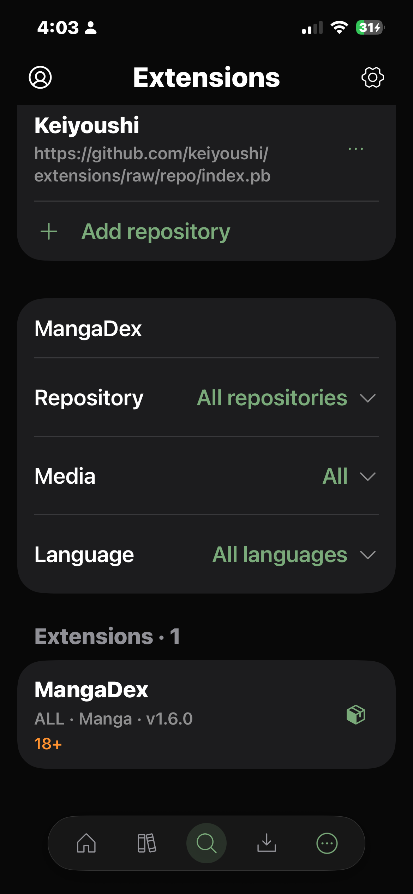

# Extensions loading recovery

Physical iPhone 13 Pro, September 20, 2026. The device retained 2 repositories,
2 installed sources, and 1,651 catalog entries. The original failure did not
reproduce after relaunch; individual requests and overlapping concurrent screen
loads passed against the saved app data.

Fixed the all-or-nothing UI update, misleading empty-repository state on errors,
and duplicate initial load. Read-only catalog requests retry one transient
connection failure; mutations do not automatically retry. Failed installed-source
loading disables repository removal because dependencies cannot be checked.

Six tests passed on the physical device: four injected-failure unit tests, one
live embedded API/concurrency check, and one UI check that opens Extensions,
verifies the saved Keiyoushi repository, and searches for MangaDex. The screenshot
shows the actual device and existing source data, not fixtures.

Result: Test-Moku-2026.09.20_16-02-42--0700.xcresult.

